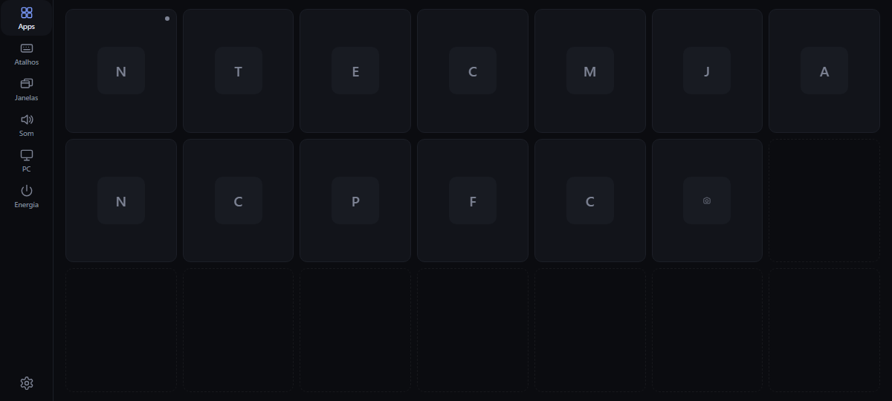
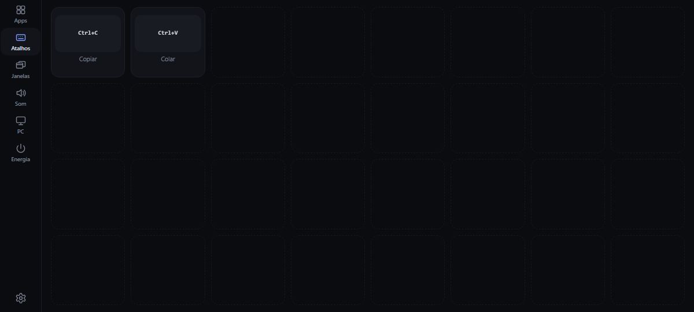
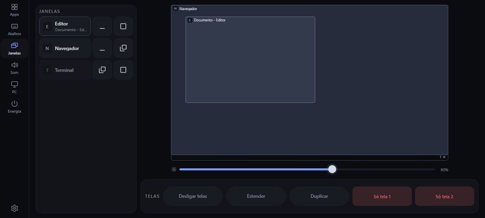
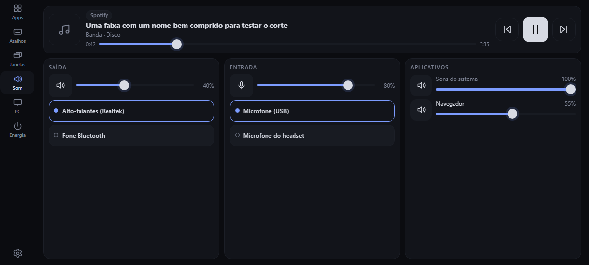
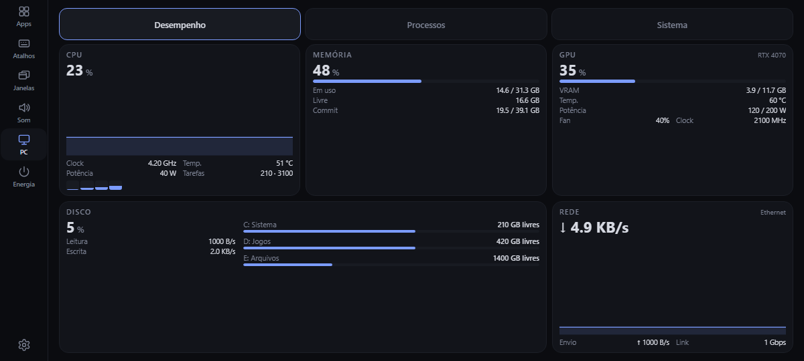
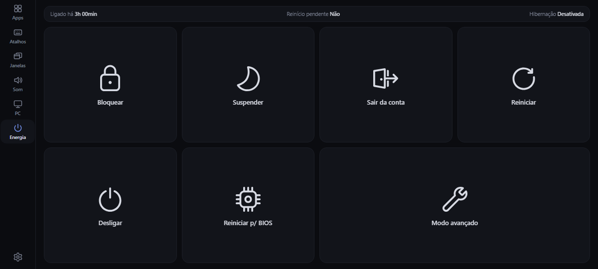
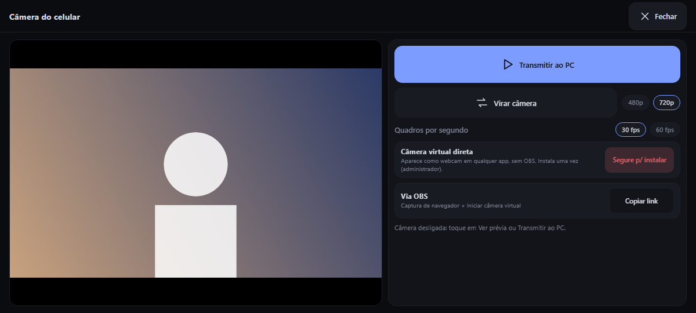

# Self Stream Deck

Transforma um celular em um painel de controle do seu PC com Windows: abrir programas, disparar atalhos, ajustar o som, controlar a mídia, vigiar o desempenho, organizar janelas, desligar o PC e até usar a câmera do celular como webcam.



| | |
|---|---|
| **Agente no PC** | um único `ssd.exe` em Rust (~5 MB, uns 40–70 MB de memória), com a interface dentro; sem Node, sem serviços de terceiros |
| **Painel** | React + TypeScript (PWA), servido pelo próprio agente; funciona no app Android, no Safari do iPhone e em qualquer navegador |
| **App Android** | casca fina em Kotlin (WebView) que guarda o endereço, mantém a tela ligada e vibra ao toque |
| **Rede** | USB (`adb reverse`) ou Wi-Fi da casa por HTTPS com certificado próprio fixado pelo app; nada passa pela internet |
| **Versão** | 0.1.x · Windows 10/11 · Android 7+ · iOS 16.4+ (Safari) · licença MIT |

## O que ele faz

<table>
<tr>
<td width="50%"><br><b>Atalhos</b> de teclado e <b>macros</b> (várias ações em um toque), editáveis no próprio celular.</td>
<td width="50%"><br><b>Janelas</b>: um mapa em escala das suas telas, com arrastar, encaixar, minimizar, brilho e projeção.</td>
</tr>
<tr>
<td><br><b>Som</b>: o que está tocando (capa, tempo, controles), saída e entrada, volume por aplicativo.</td>
<td><br><b>PC</b>: CPU, memória, GPU, disco e rede ao vivo; processos; hardware; FPS do jogo.</td>
</tr>
<tr>
<td><br><b>Energia</b>: bloquear, suspender, reiniciar, desligar, com confirmação por toque longo e contagem regressiva.</td>
<td><br><b>Câmera do celular</b> como webcam do PC, direto (sem OBS) ou via OBS; 720p e até 30 fps.</td>
</tr>
</table>

Também: notificações do Windows no painel (mesmo com "Não incomodar"), um relógio na lateral do app, uma tela de reconexão que tenta de novo sozinha, **Bloquear tela** do celular quando o PC some, e atualização automática opcional do agente.

## Como funciona

```
┌──────────────────┐   HTTP (USB, adb reverse)  ou  HTTPS (Wi-Fi)   ┌───────────────────────────┐
│ Celular          │ ─────────────────────────────────────────────▶ │ ssd.exe (Rust, no PC)     │
│  app Android /   │ ◀── interface, ícones, dados, eventos (SSE) ── │  • API (51 operações)     │
│  Safari (iPhone) │                                                │  • APIs diretas do Windows│
└──────────────────┘                                                └───────────────────────────┘
```

O agente fala com o Windows por APIs nativas (Core Audio, SMTC, DWM, PDH, WMI…), expõe uma API HTTP descrita em [`contracts/openapi.yaml`](contracts/openapi.yaml) e entrega o painel. O celular só **mostra e envia toques**: a lógica fica toda no PC, então mudar o painel não exige recompilar o app. Detalhes em [docs/ARQUITETURA.md](docs/ARQUITETURA.md).

## Início rápido

1. **Instale o agente no PC.** Gere o instalador (veja [instalação](docs/instalacao.md)) e dê dois cliques em `SelfStreamDeck-<versão>.msi`. Ele pede administrador uma vez, instala em `Program Files`, cria o atalho e inicia o agente (sem janela; um ícone aparece perto do relógio).
2. **Pegue o código de pareamento.** Clique com o botão direito no ícone da bandeja → *Mostrar código de pareamento*.
3. **Instale o app no celular.** Android: o APK (veja [desenvolvimento](docs/desenvolvimento.md#app-android)). iPhone: nada a instalar, abra o link no Safari ([passo a passo](docs/rede-e-seguranca.md#iphone-safari-e-tela-de-início)).
4. **Conecte.** Por USB: `adb reverse tcp:7878 tcp:7878` e abra o app. Pelo Wi-Fi: ligue `"lan": true` no `config.json` e cole o link `https://IP:7879/?token=…&fp=…` na tela "Conectar ao PC".

Algo não conectou? Veja a [solução de problemas](docs/solucao-de-problemas.md) ou rode `ssd.exe diagnose`.

## Requisitos

| Parte | Precisa de |
|---|---|
| Uso | Windows 10 ou 11 (64 bits), um celular Android 7+ (ou um iPhone com iOS 16.4+), PC e celular na mesma rede ou ligados por USB com depuração ativa |
| Desenvolvimento | Rust (estável), Node 20+, e para o app JDK 17 + Android SDK (o repositório usa os seus em `.tools/`). Veja [desenvolvimento](docs/desenvolvimento.md) |

## Documentação

| Guia | Para quê |
|---|---|
| [Índice](docs/README.md) | por onde começar |
| [Guia de uso](docs/guia-de-uso.md) | cada página do painel, o editor de botões e as macros |
| [Instalação](docs/instalacao.md) | MSI, zip, atualização, desinstalação, dados e migração |
| [Configuração](docs/configuracao.md) | todas as chaves do `config.json`, portas e variáveis de ambiente |
| [Rede e segurança](docs/rede-e-seguranca.md) | USB, Wi-Fi com certificado fixado, iPhone, firewall e o que o agente nunca faz |
| [Câmera](docs/camera.md) | webcam do celular, câmera virtual, OBS e desempenho |
| [Solução de problemas](docs/solucao-de-problemas.md) | sintomas conhecidos e o que fazer |
| [Desenvolvimento](docs/desenvolvimento.md) | compilar, testar, empacotar, assinar, publicar atualizações |
| [Arquitetura](docs/ARQUITETURA.md) | como as peças se encaixam, a API e os eventos |
| [Contrato da API](contracts/README.md) | OpenAPI 3.1 e como o agente é conferido contra ele |
| [Decisões (ADRs)](docs/adr/README.md) | por que Rust, React, OpenAPI, SSE… |
| [Histórico](docs/plano-reestruturacao.md) | o plano da reestruturação, [a retrospectiva](docs/retrospectiva.md) e os incidentes |

## Estrutura do repositório

```
agent/        o agente do PC (Cargo workspace: core, api, platform-windows, agent) e os scripts de instalação
web/          o painel (React + TypeScript + Vite) e seus testes de navegador
android/      o app Android (Kotlin)
contracts/    openapi.yaml e o PC de mentira usado nos testes
tools/        check.js (tudo), contract-test, agent-check, update-check, screenshots, hooks
docs/         esta documentação, ADRs e imagens
```

## Desenvolvimento em uma linha

```powershell
node tools/check.js          # formatação, lints, testes do Rust e do painel, e o agente contra o contrato
```

Mais em [CONTRIBUTING.md](CONTRIBUTING.md) e [docs/desenvolvimento.md](docs/desenvolvimento.md).

## Segurança em resumo

- O agente escuta só em `127.0.0.1` por padrão; o Wi-Fi é opcional, em outra porta, com **HTTPS e certificado fixado pela impressão digital** e uma regra de firewall só para a sub-rede local.
- Todo pedido exige o **token de pareamento**; `Host` e `Origin` são conferidos; dez falhas bloqueiam o endereço por um minuto.
- O celular só dispara o que o agente lista (apps da barra de tarefas, atalhos do `config.json`, dispositivos que existem): nunca caminhos, comandos ou teclas arbitrárias.
- Atualizações só são instaladas se vierem por HTTPS, com o SHA-256 do manifesto e **assinadas pelo mesmo certificado do agente**.

Detalhes e limites em [docs/rede-e-seguranca.md](docs/rede-e-seguranca.md).

## Estado e limitações

Funciona e é usado no dia a dia, mas é um projeto jovem (0.1.x):

- O Windows mostra "editor desconhecido" ao instalar: a assinatura é com certificado próprio. Um certificado de uma autoridade resolve, e o script de assinatura já aceita um `.pfx`.
- A câmera do celular é limitada pela câmera do aparelho: o Galaxy A31 faz até 30 fps e menos em pouca luz; 60 fps só em celulares cuja câmera entrega 60.
- O vigia do `adb reverse` (refazer o túnel USB ao plugar) não existe: por USB rode o comando uma vez a cada conexão. Pelo Wi-Fi não precisa.
- O certificado do iPhone só é refeito quando falta, não quando o IP do PC muda.
- Não foi testado numa instalação limpa (sem as pastas do projeto) nem a câmera no iPhone.

A lista completa e o histórico estão na [retrospectiva](docs/retrospectiva.md).

## Créditos e licença

- A câmera virtual direta usa o filtro de código aberto [UnityCapture](https://github.com/schellingb/UnityCapture) (licença zlib), baixado de um commit fixo e conferido por SHA-256 na primeira instalação.
- O projeto é distribuído sob a **licença MIT** (veja [`LICENSE`](LICENSE)). As dependências do agente (crates do Rust) e do painel (pacotes do npm) têm as suas próprias licenças, que não foram auditadas aqui: confira-as antes de redistribuir um pacote.
