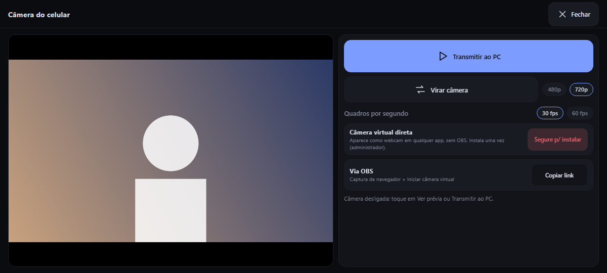

# Câmera do celular

O celular vira a webcam do PC. Nada é gravado nem guardado: só o último quadro fica em memória.



## Como funciona

```
 câmera do celular ─▶ painel (JPEG por quadro) ─▶ POST /api/camera/frame ─▶ ssd.exe
                                                                              │
                              ┌───────────────────────────────────────────────┤
                              ▼                                               ▼
                 GET /api/camera/stream (MJPEG)              câmera virtual DirectShow
                      para o OBS (fonte "Captura de navegador")    "Stream Deck Camera"
```

A página pede a câmera ao celular, desenha os quadros num canvas, codifica cada um em JPEG e os envia ao agente. O agente os republica de dois jeitos, **ao mesmo tempo**: um stream MJPEG (para o OBS) e uma câmera virtual (para qualquer app).

## Ligar

- **Tecla de câmera** na tela de Apps: um toque liga ou desliga a transmissão (fica vermelha enquanto transmite). É o jeito mais rápido.
- **⚙ → Câmera do celular → Transmitir ao PC**: a página com as opções. O app pede a permissão da câmera na primeira vez ("Durante o uso do app"). *Ver prévia* mostra a câmera sem transmitir.
- Um ícone vermelho de câmera no cabeçalho indica que está transmitindo.

A câmera só liga quando você pede; abrir a página não a liga.

## Usar no PC

### Câmera virtual direta (sem OBS)

Na página da câmera, segure **Segure p/ instalar** (uma vez). Isso instala o filtro de código aberto [UnityCapture](https://github.com/schellingb/UnityCapture) (um DLL de 157 KB, baixado de um commit fixo, **conferido por SHA-256** e registrado com `regsvr32`; exige administrador, que o agente já tem). Depois aparece uma câmera chamada **Stream Deck Camera** no Discord, Zoom, Meet, no navegador etc., ao lado das webcams reais. **Segure p/ remover** desfaz.

Os quadros só são entregues ao filtro enquanto algum app está **usando** a câmera.

### Via OBS

Na página da câmera, toque em **Copiar link**; no OBS adicione uma fonte **Captura de navegador** e cole o link (Ctrl+V); clique em **Iniciar câmera virtual** e escolha **OBS Virtual Camera** no app.

Sem sinal do celular o stream mostra uma imagem "Sem sinal".

## Qualidade e desempenho

| Controle | O que muda |
|---|---|
| **480p / 720p** | a largura da imagem enviada (854 ou 1280 pixels). **720p é o padrão.** |
| **30 fps / 60 fps** | o **teto** de quadros por segundo (padrão 30). Quem manda é a câmera do aparelho: se ela entrega 30, 60 não acrescenta nada. A câmera é aberta pedindo essa taxa; uma que não a entrega dá o que puder. |
| **Virar câmera** | frontal ↔ traseira |

A linha de status no fim da página mostra o que está acontecendo:

> Transmitindo · 18 fps · 1600 KB/s · câmera direta em uso · câmera 20 fps · cod. 42 ms

Os dois primeiros números são o que o **PC recebe**; "câmera N fps" é o que a câmera do celular **entrega**; "cod." é quanto o celular leva para codificar cada quadro. Se "câmera" é baixo, o limite é a luz ou o aparelho; se "cod." é alto, é a codificação.

### O que esperar (medido num Galaxy A31, por USB)

| | |
|---|---|
| Câmera em ambiente escuro | 20–23 fps |
| Câmera com boa luz | até 30 fps |
| Codificação de um quadro 720p | 42–53 ms (era 124 ms antes de usar um canvas em software) |
| O PC recebe | 17–19 fps em ambiente escuro, chegando perto do que a câmera entrega |
| Custo no PC | ~33% de um núcleo (~2% da máquina) a esse ritmo; decodificar e converter um quadro 720p leva 6 ms |
| Banda | ~1,6 MB/s a 720p |

**60 fps não é alcançável no A31** (a câmera faz 30 no máximo); a opção existe para celulares que entregam 60.

### Como melhorar

- **Luz.** Em pouca luz a câmera baixa a taxa sozinha: é o principal fator.
- **480p** se o celular esquentar ou a imagem engasgar: o custo de codificação cai, embora o ganho de fps seja pequeno.
- **Wi-Fi 5 GHz ou USB** em vez de um Wi-Fi fraco. O envio tolera latência (até 4 quadros ficam em andamento), mas um link lento derruba quadros.
- Mantenha a tela do celular ligada e o app aberto durante a transmissão.

### Modo de espera

Quando nenhum app usa a imagem (nem o OBS, nem a câmera virtual), o celular manda **1 quadro por segundo** e a linha de status diz "Transmitindo em espera". Ele volta ao ritmo cheio assim que algum app abre a câmera. Isso economiza bateria e rede.

## Depois de reiniciar o agente

Quando o agente reinicia (uma atualização, uma queda), a transmissão do celular para: ligue a tecla de câmera de novo. E o app que estava usando a câmera (Meet, Zoom) pode ter soltado a câmera: **desligue e ligue a câmera dele** para ele reabrir o filtro.

## Problemas comuns

| Sintoma | Causa e solução |
|---|---|
| O app mostra listras verdes com "Unity has not started sending image data" | O filtro está aberto, mas nenhum quadro chega. Ligue a câmera no deck (e confira se a linha de status mostra "câmera direta em uso"). Veja [solução de problemas](solucao-de-problemas.md#a-câmera-virtual-mostra-listras-verdes-no-meet). |
| A câmera "Stream Deck Camera" não aparece | Instale-a (*Segure p/ instalar*) e reabra o app que a usa; alguns apps só leem a lista de câmeras ao abrir. |
| A imagem está de cabeça para baixo ou espelhada | A prévia do celular é espelhada na câmera frontal só para quem olha; o PC recebe a imagem sem espelhar. O Meet também espelha a sua própria prévia. |
| Fica em 1 fps | Ninguém está usando a câmera (modo de espera). Abra-a no app que vai usá-la. |
