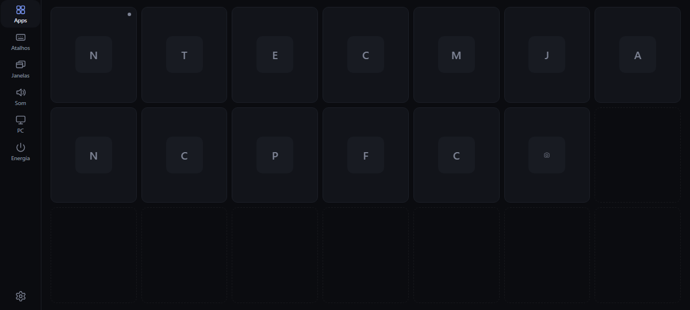
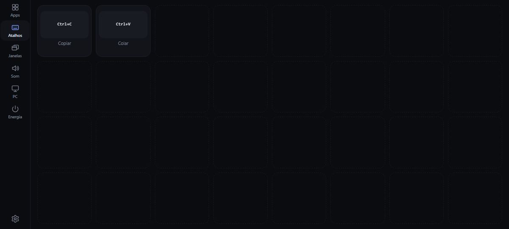
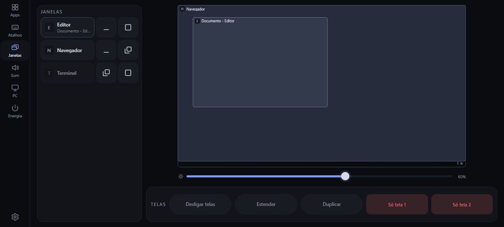
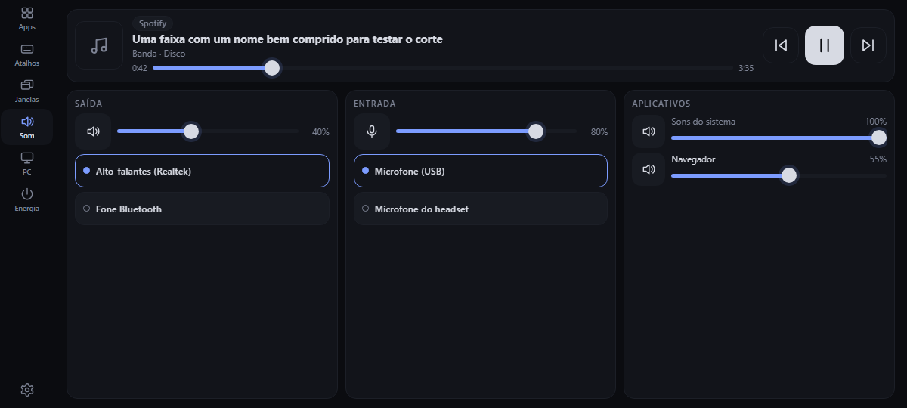
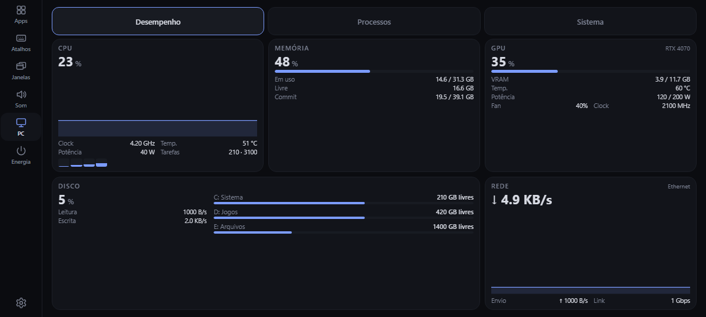
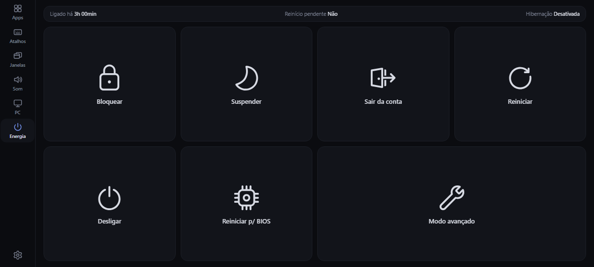

# Guia de uso

O painel é dividido em **páginas**, agrupadas em **seis abas** fixas (uma faixa vertical à esquerda em paisagem, uma barra embaixo em retrato). Não há rolagem na tela principal.

- Tocar numa aba abre a página dela (a última que você tinha aberto naquele grupo); tocar na aba **ativa** avança para a próxima página do grupo.
- Arrastar percorre todas as páginas em ordem: para os lados em retrato, para cima e para baixo em paisagem.
- O botão **⚙** abre o menu: nome do PC, *Editar botões*, *Câmera do celular*, *Escurecer após…*, *Endereço do PC…* e *Atualizar*.
- Quando o PC não responde, uma barra vermelha aparece no topo com **Tentar agora** (e, dentro do app Android, **Bloquear tela**).

## Apps

Os aplicativos **fixados na barra de tarefas** do Windows, na ordem em que você os arrumar.

- Ponto **verde**: o programa tem janela aberta; tocar o traz para a frente. Ponto **cinza**: o processo está rodando, sem janela.
- Tocar num programa fechado o abre. O painel nunca recebe um caminho: só o identificador de um item da barra de tarefas.
- Todos os apps cabem numa página (as teclas encolhem); só com muitíssimos apps a página rola na vertical.
- A tecla de **câmera** liga e desliga a transmissão da câmera do celular ([câmera](camera.md)).

### Reorganizar

Segure uma tecla por meio segundo (ela levanta e o celular vibra), arraste e solte **sobre outra tecla: as duas trocam de lugar**. Soltar num espaço vazio manda a tecla para o fim. Vale para apps, atalhos, macros e a tecla da câmera, e a ordem é guardada ao soltar.

## Atalhos

Atalhos de teclado e macros, em grade. Os atalhos vêm do `config.json` e podem ser criados no próprio celular (veja o editor abaixo). O volume e o mudo ficam na aba Som.

## Janelas

Um **mapa em escala das suas telas**, com cada janela desenhada onde ela está.

- **Arraste** uma janela para movê-la, inclusive de uma tela para outra; arraste até a borda esquerda ou direita de uma tela para **encaixar** (metade da tela) ou até o topo para **maximizar**.
- **Toque** numa janela para selecioná-la (e trazê-la para a frente); toque no vazio para desmarcar.
- A lista de todas as janelas (inclusive minimizadas) fica no topo; as ações da selecionada ficam à direita: minimizar, maximizar ou restaurar, esquerda, direita, outra tela e fechar (com dois toques).
- Sem seleção, esse espaço mostra os controles das telas: desligar telas e projeção (estender, duplicar; "só tela 1" e "só tela 2" exigem segurar). O **brilho** de cada monitor (DDC/CI) fica logo abaixo dele no mapa.

## Som

- **Mídia** (a faixa no topo): o que está tocando, de qualquer player ou navegador, com capa, título, artista, barra de tempo com busca e anterior/play/próxima. Vários players viram abas.
- **Saída**, **Entrada** e **Aplicativos**: trocar o dispositivo padrão, volume e mudo de cada um (inclusive o microfone) e o volume de cada aplicativo.

## PC

Três painéis: **Desempenho** (CPU total e por núcleo, clock, temperatura e potência, memória, GPU, disco e rede, ao vivo), **Processos** (os que mais usam CPU e memória) e **Sistema** (hardware e Windows: processador, memória, vídeo, placa-mãe e BIOS, armazenamento, rede, monitores, uptime).

Com um jogo desenhando quadros, o cartão da GPU mostra o **FPS** e o tempo de quadro (lidos do RTSS, o mesmo do MSI Afterburner).

**Fontes opcionais:** o Windows não expõe os sensores de temperatura, potência e clock reais de todo processador; o painel os lê do **MSI Afterburner** (memória compartilhada) quando ele está aberto, e sem ele esses campos ficam em "–". A GPU vem do `nvidia-smi` (placas NVIDIA); sem ele o cartão da GPU fica vazio.

## Energia

Teclas para bloquear, suspender, hibernar, sair da conta, reiniciar, desligar e reiniciar para a BIOS ou para o menu avançado.

**Como a segurança funciona:** tudo que encerra a sessão abre uma janela que explica o efeito, lista as janelas abertas (podem ter trabalho não salvo) e **só confirma se você segurar o botão por ~1,2 s**. Reiniciar, desligar e as opções de BIOS podem ser agendados (de 10 s a 2 h); o agendamento aparece como contagem no cabeçalho em qualquer página e pode ser cancelado. Com atraso, o Windows força o fechamento dos apps (a regra do `shutdown /t`), e a janela avisa. Para remover essas ações da API: `"powerControls": false` no `config.json`.

## Editor de botões e macros

Menu **⚙ → Editar botões** (ou direto no `config.json`). Três abas:

- **Atalhos:** criar, renomear e excluir atalhos de teclado (modificadores Ctrl, Shift, Alt, Win e uma tecla). **Testar** salva e aperta uma vez.
- **Macros:** uma lista de passos executados em ordem com um toque (a tecla mostra "n passos" e fica marcada enquanto roda). Passos disponíveis: abrir ou focar um app; posicionar a janela de um app (metade esquerda, direita ou tela cheia, em uma tela); pressionar teclas; tecla de mídia; definir o volume; mudo do som; mudo do microfone; trocar a saída ou a entrada de áudio padrão; esperar (0,5 a 10 s); ligar ou desligar a câmera do celular. Cada macro escolhe em que página aparece (Atalhos ou Apps). Se um passo falha (app fechado, dispositivo ausente), os outros continuam e o aviso diz quantos falharam.
- **Apps:** ocultar ou mostrar os apps da barra de tarefas.

**Segurança:** o agente só aceita passos de uma lista fixa e confere tudo ao salvar (apps por identificador da barra de tarefas, dispositivos pela lista atual, teclas pelos nomes conhecidos). Não existe passo de linha de comando, caminho de arquivo, texto digitado ou energia. Mesmo assim, quem tem o token passa a poder montar atalhos de teclado pelo celular; para impedir, ponha `"editor": false` no `config.json`.

## Notificações

O painel pode mostrar as notificações do Windows de alguns aplicativos, mesmo com "Não incomodar" ou um jogo em tela cheia. Configure em `"notifications"` ([configuração](configuracao.md#notificações)).

## Escurecer a tela

*⚙ → Escurecer após…* apaga a tela do celular depois de 1, 2 ou 5 minutos sem toque (o primeiro toque só acorda). No app Android baixa o brilho do sistema ao mínimo; no iPhone é um véu preto, sem baixar o brilho. O relógio do app some junto.
